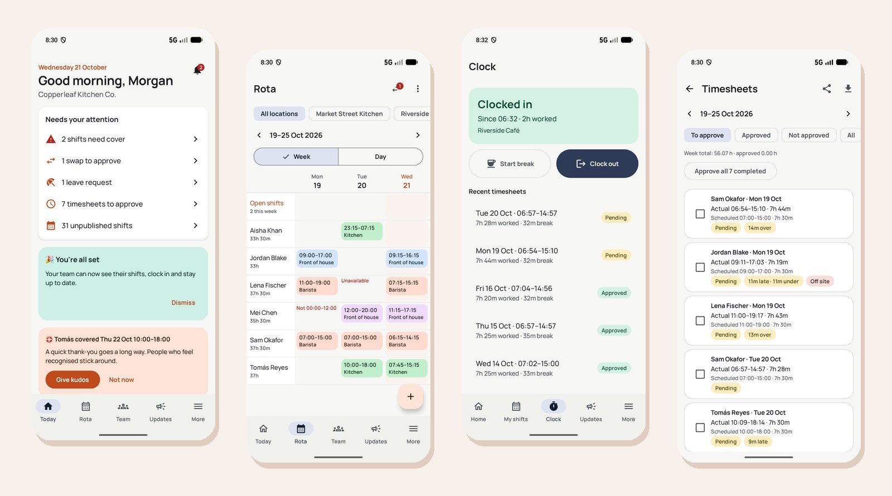
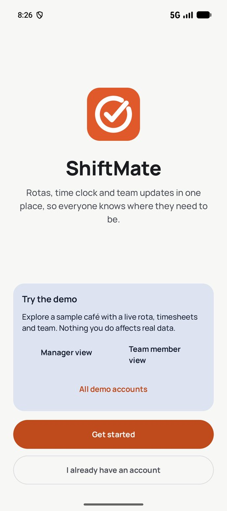
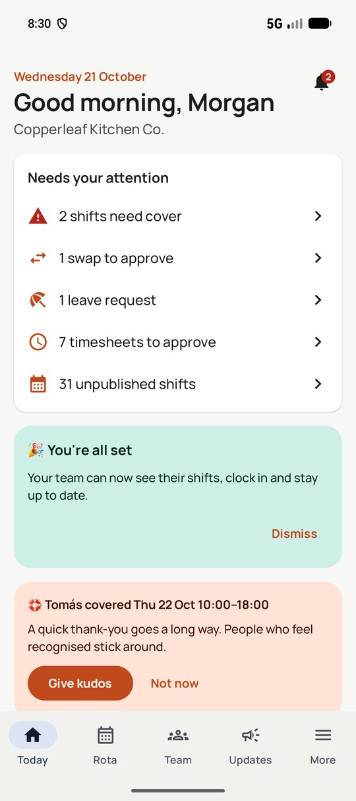
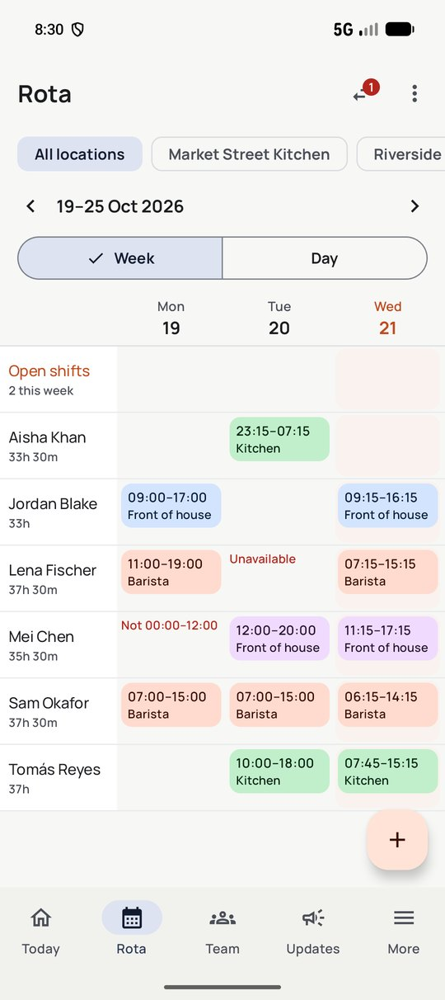
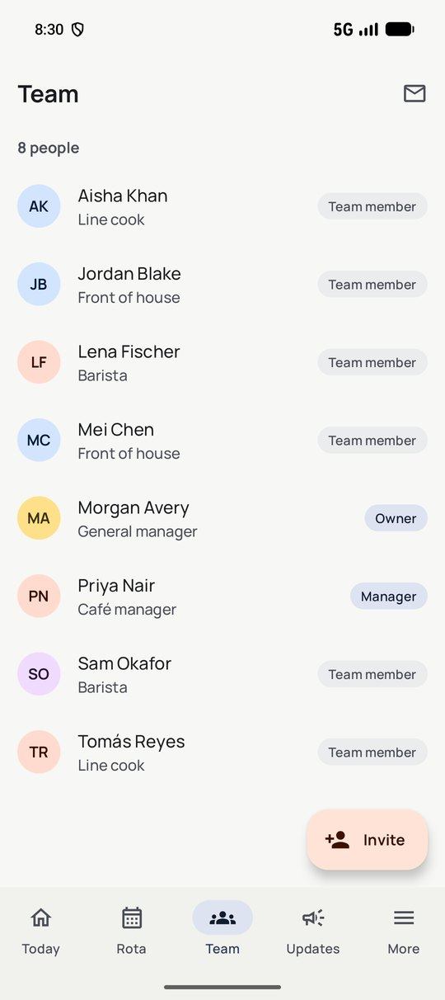
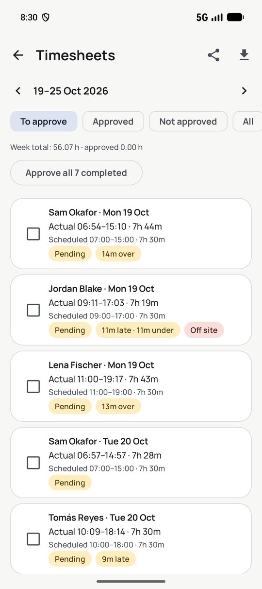
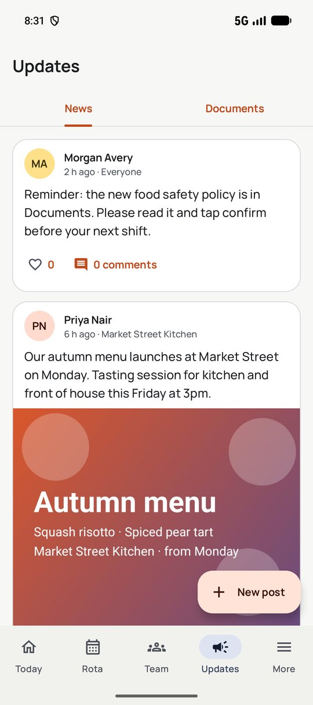
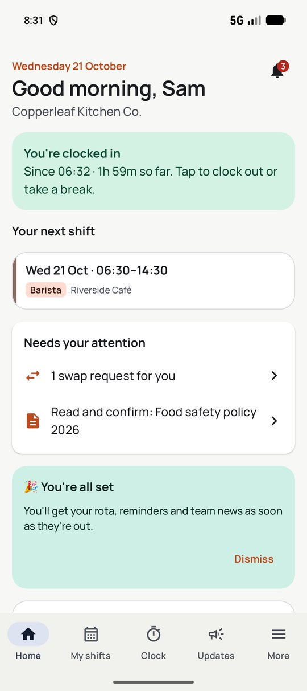
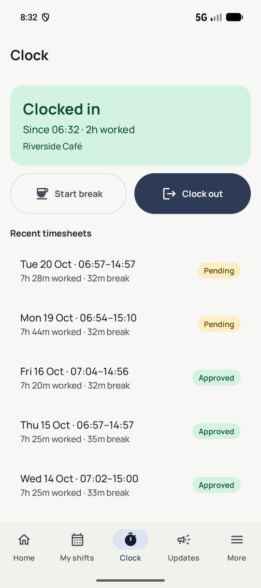

# ShiftMate

**Rotas, time clock and team updates in one app, built for shift-based teams like cafés, restaurants and retail.**

> This repository is a public showcase. The source code is private.

## What it does

ShiftMate replaces the group chat, the paper rota and the timesheet spreadsheet with one app.
**Managers** plan the week, approve hours and keep the team informed.
**Team members** see their shifts, clock in on site, swap shifts and book time off.

### For managers
- **Weekly rota** across locations and areas: open shifts, cover requests, publish with one tap
- **Timesheet approval**: late, early, over and off-site flags; bulk approve; export for payroll
- **Leave and swaps**: approve requests with balances checked automatically
- **Team management**: invite codes, five roles (Owner, Admin, Manager, Team leader, Employee) with fine-grained permissions, offboarding
- **"Needs your attention"** dashboard so nothing slips

### For team members
- **My shifts**: upcoming shifts, open shifts to pick up, swap requests
- **Clock in and out** with location check and breaks
- **Time off** and availability
- **News, documents to read and confirm, tasks**
- **Kudos**, streaks and reminders that keep people engaged

## Screens

| Welcome | Manager · Today | Rota | Team |
|:-:|:-:|:-:|:-:|
|  |  |  |  |
| **Timesheets** | **Updates** | **Team member · Home** | **Clock** |
|  |  |  |  |

## Try it

1. Download **ShiftMate-Demo.apk** from the [latest release](../../releases/latest) on an Android phone (Android 8 or newer).
2. Open it and allow installing from your browser if Android asks.
3. On the welcome screen tap **Manager view** or **Team member view**.

The demo runs entirely on the phone with a sample café, so nothing you do affects real data.

## How it's built

- **Android:** Kotlin, Jetpack Compose, Material 3, Hilt, MVVM, type-safe Navigation, CameraX, Play Services Location
- **Backend:** Firebase Auth, Cloud Firestore, Cloud Functions (TypeScript, Node 22)
- **Security:** every privileged action (roles, invites, offboarding) runs server-side in transactions with an audit log;
  Firestore security rules isolate each organisation's data; covered by end-to-end tests on the Firebase emulators
- **Two builds:** an offline demo with sample data, and the live app connected to Firebase

## Status

In active development. Sign-in, organisations, invites, roles and team management run on Firebase;
rota, time clock, leave and messaging are moving to the cloud next, followed by recognition and rewards.

---

Designed and built by **[Sabeeh Dayyan](https://github.com/Sabeeh-Dayyan)** · © 2026 Sabeeh Dayyan. All rights reserved. 
Source code is available to employers and clients on request.

